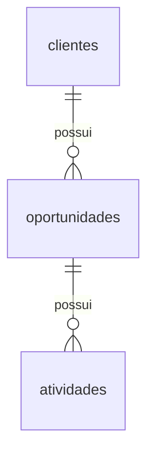

# Sistema Atlas

CRM comercial full stack em PHP, MySQL, HTML, CSS e JavaScript puro. O projeto oferece uma interface para gerenciar clientes, oportunidades comerciais, atividades de follow-up e indicadores de pipeline.

O codigo principal esta na pasta:

```text
sistema-atlas/
```

## Recursos

- Cadastro, edicao, listagem e exclusao de clientes.
- Cadastro e gestao de oportunidades comerciais.
- Controle de atividades de follow-up.
- Dashboard com metricas de clientes, oportunidades, pipeline e pendencias.
- API PHP com respostas JSON padronizadas.
- Banco relacional MySQL com script SQL.
- Validacoes de entrada, headers de seguranca e rate limit simples.

## Stack

- PHP 8+
- MySQL ou MariaDB
- PDO
- HTML5
- CSS3
- JavaScript
- XAMPP para ambiente local

## Estrutura

```text
sistema-atlas/
├── api/          # Endpoints PHP
├── config/       # Conexao com banco
├── database/     # Script SQL
└── public/       # Interface web
```

## Como rodar no XAMPP

1. Copie a pasta `sistema-atlas` para `C:\xampp\htdocs\sistema-atlas`.
2. Inicie Apache e MySQL no XAMPP.
3. Abra `http://localhost/phpmyadmin`.
4. Importe o arquivo `sistema-atlas/database/schema.sql`.
5. Acesse:

```text
http://localhost/sistema-atlas/public/
```

## Configuracao do banco

Arquivo:

```text
sistema-atlas/config/banco.php
```

Padrao local:

- Host: `127.0.0.1`
- Porta: `3306`
- Banco: `sistema_atlas`
- Usuario: `root`
- Senha: vazia

## API

Endpoint principal:

```text
sistema-atlas/api/index.php
```

Entidades suportadas:

- `clientes`
- `oportunidades`
- `atividades`
- `dashboard`

Exemplo:

```text
GET /sistema-atlas/api/index.php?entidade=dashboard
```

## Status

Projeto de portfolio com foco em CRUD, dashboard comercial, organizacao full stack e boas praticas basicas de backend.

## Arquitetura, API e banco

`public/app.js` envia JSON ao front controller `api/index.php`, que valida entradas e usa `config/banco.php` para acessar MySQL via PDO. Não há autenticação: o projeto demonstra CRUD e modelagem de CRM e precisa de controle de acesso antes de receber dados reais.



As FKs usam atualização/exclusão em cascata. **`database/schema.sql` contém `DROP TABLE` e recria tabelas**: use somente em banco local descartável após leitura. Não é migration incremental e não foi executado nesta auditoria.

`api/index.php?entidade=...` aceita GET/POST/PUT/DELETE para `clientes`, `oportunidades`, `atividades`; atualização/exclusão usam `id` na query string. `dashboard` aceita GET. POST/PUT recebem JSON. Exemplo: `GET /sistema-atlas/api/index.php?entidade=clientes`.

## Configuração efetiva

Requer PHP 8+, PDO MySQL e mbstring. A conexão é definida diretamente em `sistema-atlas/config/banco.php`; **não há suporte a `.env` ou `DB_*`**. Ajuste sua cópia local para banco de desenvolvimento sem versionar credenciais. Os arquivos `.htaccess` anteriormente mencionados no README interno não estão versionados; a proteção de `config/` e do SQL depende da configuração real do servidor.

## Testes e evolução

Não há suíte automatizada ou deploy verificado. Rate limit por arquivo temporário e CORS local não substituem autorização. Prioridades: login/perfis, testes das FKs/cascatas e proteção dos arquivos de configuração. Não há licença versionada.
